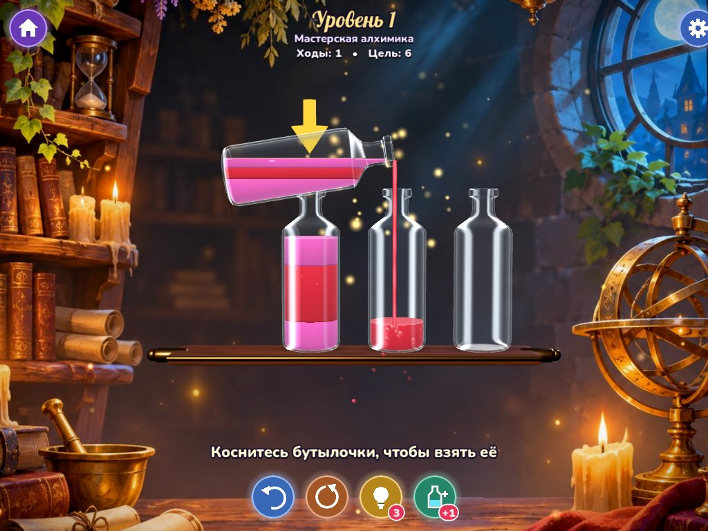
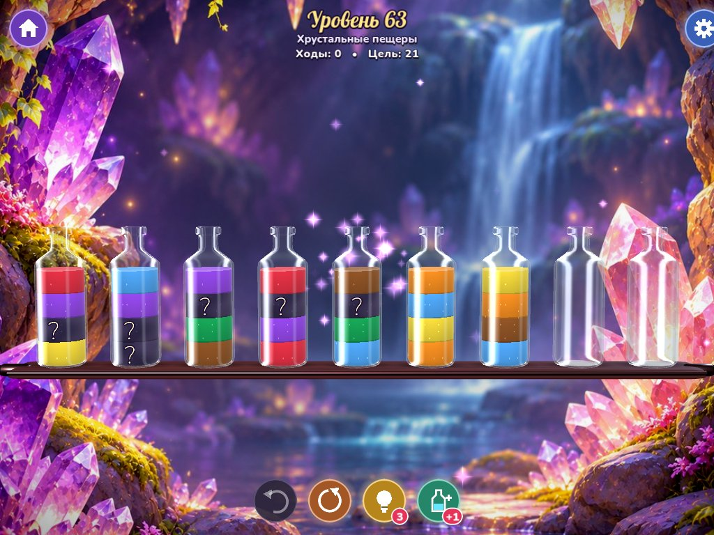
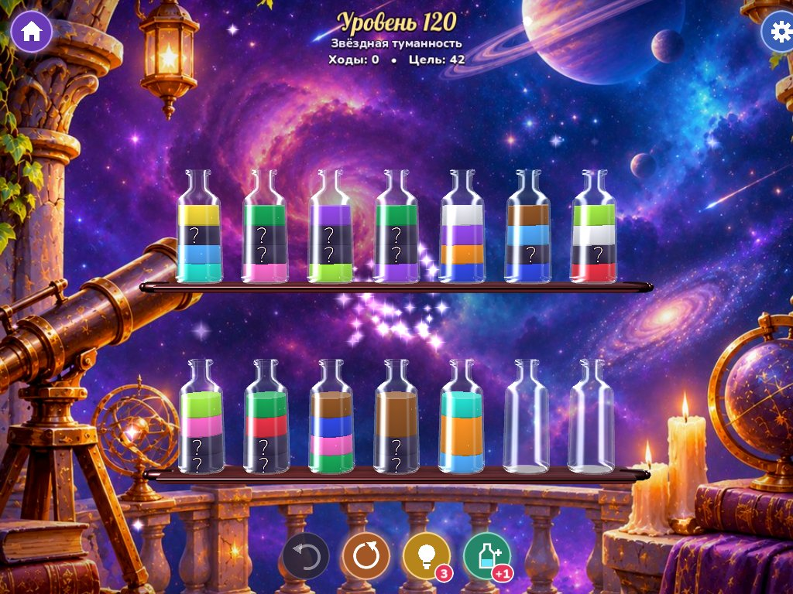

# Magic Bottles · Волшебные бутылочки

A cozy 3D water-sort puzzle made in Godot 4: pour glowing potions between glass bottles until every bottle holds a
single colour. 120 hand-checked levels in six painted worlds, hidden layers, hints, undo, stars — and liquids that
actually tilt, stream and slosh.

**Play in the browser:** https://severance.lol/8/ · **Android APK:** https://severance.lol/8/MagicBottles.apk

Everything about building, testing and deploying is in [AGENTS.md](AGENTS.md); asset licences in
[assets/CREDITS.md](assets/CREDITS.md).
